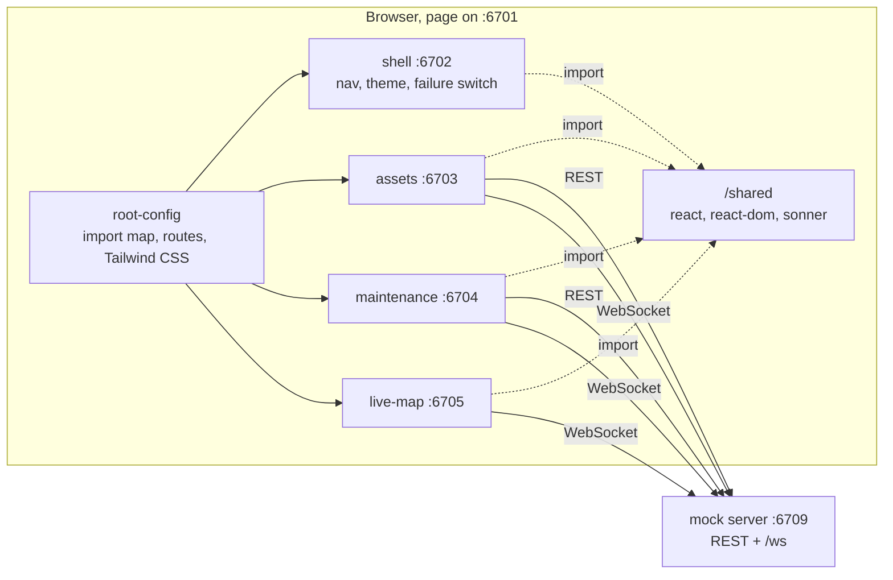

# Fleet Ops Dashboard

A fleet operations dashboard built as **single-spa micro-frontends**, running entirely on
mock data. Three independently built apps (assets, maintenance, live map) plus a shell are
composed in the browser by a root config, share one React instance through an import map,
and get live updates from a small WebSocket mock server.

It is a portfolio project. It demonstrates frontend patterns for operational dashboards; it
is not a product and has no real backend, auth or persistence.

## What it shows

| Area                                                                              | Where                                                     |
| --------------------------------------------------------------------------------- | --------------------------------------------------------- |
| Micro-frontends with single-spa, shared dependencies through an import map        | `apps/root-config`, `tooling/`                            |
| Virtualized table (TanStack Table + TanStack Virtual), up to 1,000 rows per page  | `apps/assets`                                             |
| Server-side pagination, sorting, filtering and search, with state in the URL      | `apps/assets`, `apps/maintenance`, `packages/app-runtime` |
| Optimistic updates with per-item rollback (TanStack Query)                        | `use-update-asset-status.ts`, `work-order-mutations.ts`   |
| Live updates over WebSockets, reconnect with backoff, stale detection             | `packages/fleet-api/src/live.ts`, `apps/live-map`         |
| Loading, empty and error states, plus a switch that makes the API fail on purpose | every app, shell header                                   |
| shadcn/ui components with light, dark and system themes                           | `packages/ui`                                             |
| One Zod contract shared by the mock server and the client                         | `packages/fleet-api/src/schemas.ts`                       |

## Architecture



- **Root config** (`apps/root-config`) registers the apps with single-spa and writes the
  import map into `index.html`. In dev each app is loaded from its own port; in a production
  build all apps sit under `/apps/<name>/` on the same origin.
- **Shared dependencies.** React 19 ships only CommonJS, so
  `scripts/build-shared-deps.ts` generates ES module entries for `react`, `react-dom`,
  `react-dom/client`, `react/jsx-runtime` and `sonner` and builds them into `/shared`. Every
  app marks those as external, so the page runs one React and one toast store.
- **Micro-frontends** are built as single ES modules that export `bootstrap`, `mount` and
  `unmount`. `packages/app-runtime` wraps each one with its QueryClient, error boundary and
  the hooks they share (URL list state, live feed, debounced search).
- **Styling.** The root config builds one Tailwind stylesheet that scans every app, so the
  page has a single preflight and the theme is just a `dark` class on `<html>`.
- **Mock server** (`server/`) is plain Node `http` plus `ws`. It seeds 5,000 assets, 400
  work orders and 80 moving vehicles from a fixed seed, validates input with the shared Zod
  schemas, adds 150 to 600 ms of latency, and broadcasts telemetry once a second. Every four
  seconds a random asset changes status, standing in for another operator.

### Simulating failures

The **API** menu in the header sets a header on every request:

- **fail writes**: mutations get a 503, so you can watch optimistic updates roll back.
- **fail everything**: reads fail too, so every list shows its error state.

The choice is stored in `localStorage` and open apps refetch as soon as it changes.

## Getting started

Requires Node 20.18 or newer (CI uses Node 22) and pnpm, which Corepack provides.

```bash
corepack enable
pnpm install
pnpm dev
```

Then open <http://localhost:6701>. `pnpm dev` starts the mock server and every app. Each
micro-frontend runs `vite build --watch` and is served by `vite preview`, so a change
rebuilds the app and you reload the page. There is no hot module replacement across
micro-frontends. The first page load can show "Waiting for the … dev server" for a few
seconds while the initial builds finish; the root config retries on its own.

To run the production build locally:

```bash
pnpm build
pnpm preview
```

### Ports

| Port | Service                          |
| ---- | -------------------------------- |
| 6701 | Root config (the page you open)  |
| 6702 | shell                            |
| 6703 | assets                           |
| 6704 | maintenance                      |
| 6705 | live-map                         |
| 6709 | Mock REST API and WebSocket feed |

### Environment variables

None are required. All are optional.

| Name                 | Used by                            | Default                 |
| -------------------- | ---------------------------------- | ----------------------- |
| `VITE_FLEET_API_URL` | apps, at build time                | `http://localhost:6709` |
| `MOCK_SERVER_PORT`   | mock server                        | `6709`                  |
| `MOCK_LATENCY_MS`    | mock server, maximum added latency | `600`                   |

## Scripts

| Command          | What it does                                                                                        |
| ---------------- | --------------------------------------------------------------------------------------------------- |
| `pnpm dev`       | Mock server plus all apps in watch mode                                                             |
| `pnpm build`     | Builds every micro-frontend, then the root config, and copies the apps into `apps/root-config/dist` |
| `pnpm preview`   | Serves that build on 6701 with the mock server on 6709                                              |
| `pnpm lint`      | ESLint (type-aware) and Prettier check                                                              |
| `pnpm typecheck` | `tsc --noEmit` in every package                                                                     |
| `pnpm test`      | Vitest across all packages                                                                          |

CI (`.github/workflows/ci.yml`) runs lint, typecheck, test and build on pushes to `main` and
on pull requests.

## Project layout

```
apps/
  root-config/   single-spa root, import map, shared-deps build, route status
  shell/         header, navigation, theme menu, API failure switch, toaster
  assets/        virtualized asset table with optimistic status edits
  maintenance/   work orders: create, start, complete, reopen
  live-map/      live vehicle positions on an SVG map
packages/
  fleet-api/     Zod schemas, typed fetch client, query keys, live socket client
  app-runtime/   single-spa lifecycles, QueryClient defaults, shared hooks
  ui/            shadcn/ui components, theme tokens, empty/error states
server/          seeded mock REST API and WebSocket feed
tooling/         micro-frontend registry and shared Vite config
```

## Testing

74 tests across 23 files (Vitest, Testing Library, jsdom for the UI):

- **mock-server (16):** filtering, sorting by priority rank, pagination, validation errors,
  failure injection, CORS, and the WebSocket snapshot and broadcast.
- **fleet-api (12):** query string round-trips, error mapping in the client, and socket
  reconnect backoff with fake timers.
- **app-runtime (11):** URL list state, the debounced search box (including staying in sync
  when the URL is cleared elsewhere), and the retry policy.
- **assets (7), maintenance (9), live-map (10), shell (4), ui (5):** optimistic updates and
  rollback that restores only the failed row, empty and error states, form validation,
  telemetry merging, stale detection and theme persistence.

The app was also checked by hand in a browser, against both the dev setup and the
production build: paging and sorting, filters and search, the virtualized list at 1,000 rows,
optimistic edits with and without failures, live updates pushed from another client,
WebSocket reconnect after a server restart, light and dark themes, a 375 px phone width and
an unknown route. There are no automated end-to-end tests.

## Limitations and trade-offs

- **Mock data only.** State lives in memory and resets when the mock server restarts. There
  is no authentication or authorization.
- **One stylesheet for all apps.** Tailwind runs in the root config, so a micro-frontend
  that uses a new utility class needs the root rebuilt too. This keeps one preflight and one
  theme, at the cost of fully independent deploys.
- **Limited sharing.** Only React, ReactDOM and sonner are shared. TanStack Query, Radix and
  Zod are bundled into each app, which is why each bundle is 80 to 115 kB gzipped. Moving
  more into the import map is possible, but every shared package then has to be upgraded
  in lockstep.
- **One socket per app.** Each mounted route app opens its own WebSocket instead of sharing
  a connection through the shell.
- **Live updates patch in place.** An asset change from the socket updates the row where it
  is, without refetching, so a row can stop matching the active filter until the next page
  or filter change. This is deliberate: rows do not jump under the cursor.
- **Optimistic work orders** show the asset ID instead of its name until the server answers.
- **The map is a projection**, not real map tiles: an SVG plot of a fictional area.
- **Dev workflow.** Watch builds instead of HMR, as described above.

## Stack

React 19, TypeScript 5.8, Vite 6, single-spa 6 with single-spa-react, TanStack Query 5,
TanStack Table 8, TanStack Virtual 3, Tailwind CSS 4, shadcn/ui (Radix), Zod 4, sonner,
lucide-react, Node `http` and `ws`, Vitest 3, Testing Library, ESLint 9 and Prettier, pnpm
workspaces.

Vite is pinned to 6.x through a pnpm override so the workspace also runs on Node 20.18,
which Vite 7 does not support.

## License

No license has been chosen yet.
