# Fleet Ops Dashboard

**An operations console for a fleet of heavy equipment: find any machine, change its
status, schedule maintenance and watch vehicles move, with live updates and failures
handled visibly.**

It is built as four React micro-frontends composed in the browser with single-spa, and runs
against a seeded mock API and WebSocket feed, so it works offline with no accounts or keys.

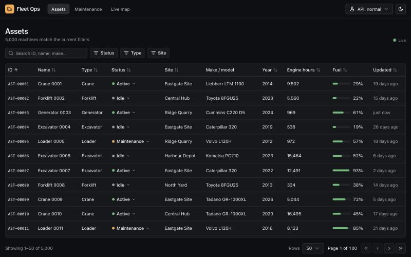

**Demo:** [45 second captioned walkthrough](docs/demo/fleet-ops-walkthrough.mp4) (MP4, made
from screenshots of the running app) · [how to run it locally](#getting-started). There is no
hosted version.

## Why it exists

Operations dashboards are where frontend work gets hard in practice. One screen holds
thousands of rows that someone needs to narrow down fast. Several teams want to ship their
part of the screen on their own schedule. Data changes underneath the user while they are
editing it, and the network fails at the worst moment.

This project works through those problems on a realistic but simulated domain: 5,000 assets
across five sites, 400 work orders and 80 vehicles reporting their position every second.
The interesting part is not the data. It is how the UI behaves when there is a lot of it,
when it changes, and when the server says no.

## What you can do with it

### Find and update any machine

The assets view pages, sorts, filters and searches on the server, up to 1,000 rows per page.
Only the rows on screen are rendered, so a full page scrolls smoothly. The whole view lives in
the URL, so a filtered list can be shared, reloaded or reached with the back button.

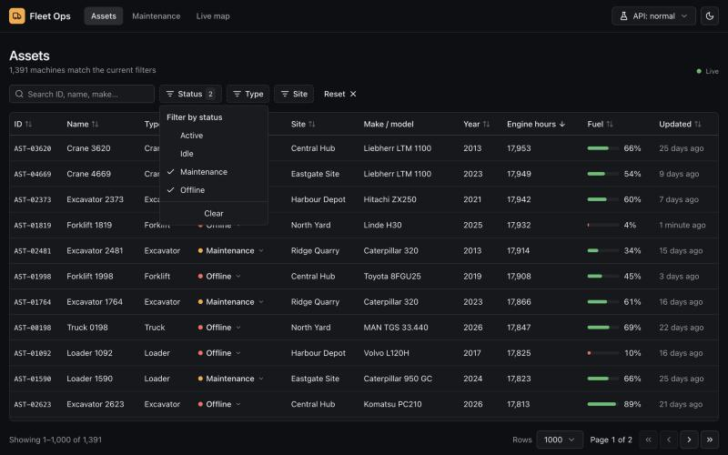

Changing a machine's status takes effect on screen immediately. If the server refuses,
only that row rolls back and a toast says why. Updates that other operators made in the
meantime are kept.

| Change shown at once                                                                              | Server refuses, row rolls back                                                             |
| ------------------------------------------------------------------------------------------------- | ------------------------------------------------------------------------------------------ |
| 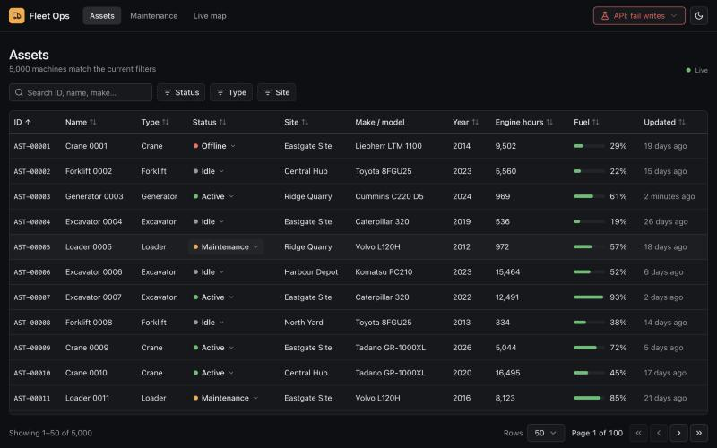 | 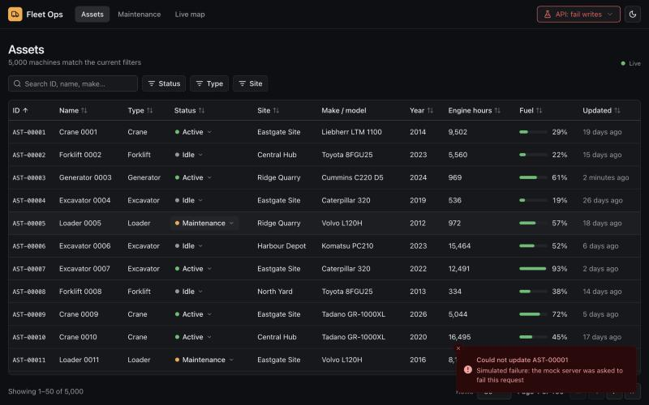 |

### Plan maintenance

Work orders can be filtered by status and priority, sorted by priority rank and moved
through open, in progress and completed. Overdue work is flagged. A new work order is
validated with the same schema the server uses, then appears in the list straight away while
it saves.

| Validation                                                                                | Created                                                                                         |
| ----------------------------------------------------------------------------------------- | ----------------------------------------------------------------------------------------------- |
| 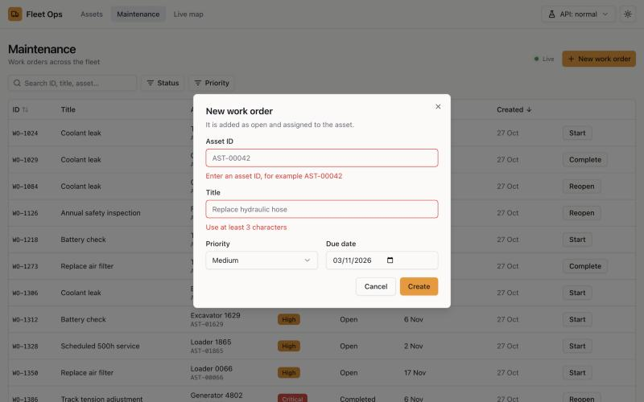 | 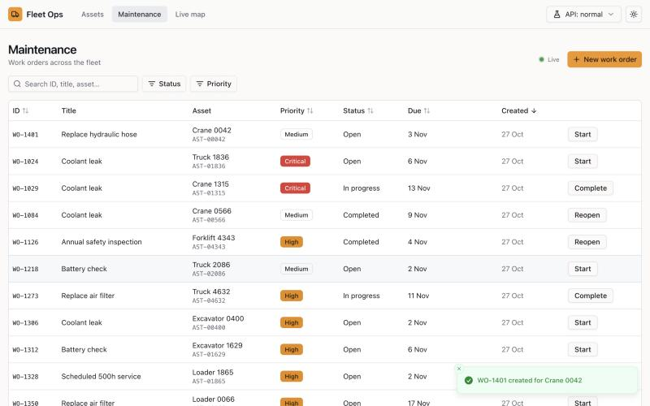 |

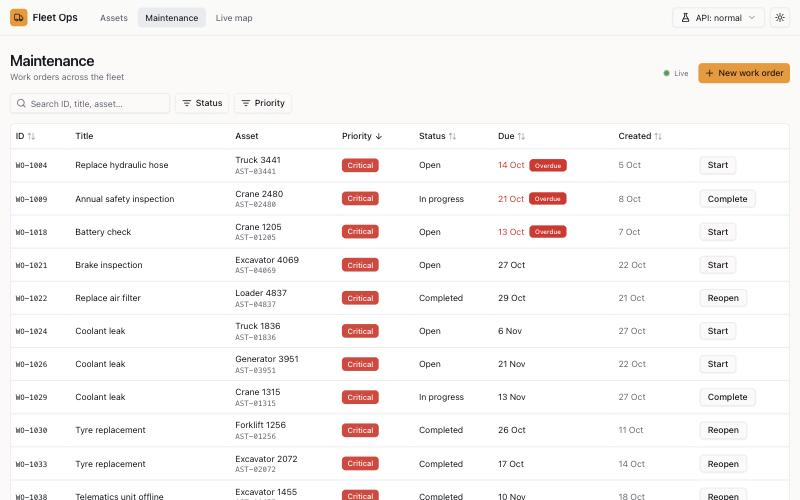

### Watch the fleet move

The live map draws every vehicle from a WebSocket feed that ticks once a second, with heading
arrows and movement eased between updates. A vehicle that stops reporting for ten seconds is
drawn as a dashed ring and listed as stale. If the connection drops, the map says so and
reconnects with backoff.

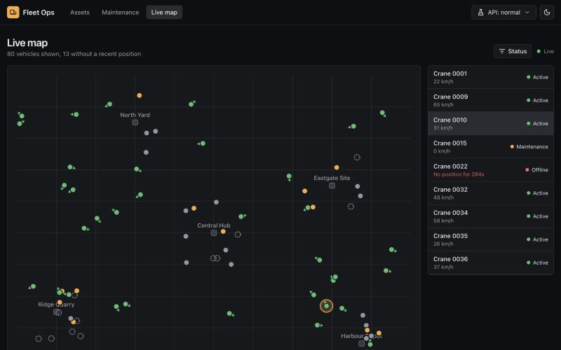

### See failure on purpose

The **API** menu in the header tells the mock server to fail every write, or every request.
Writes show the rollback above. Reads show an error state with a retry, never a blank page.
Open apps refetch the moment the switch changes.

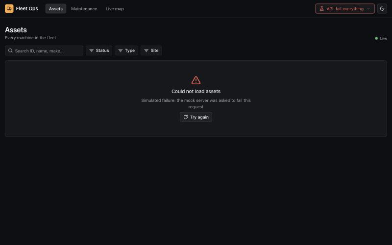

### Use it anywhere

Light, dark and system themes come from one set of tokens shared by all four apps. Every
screen works at phone width.

<p>
  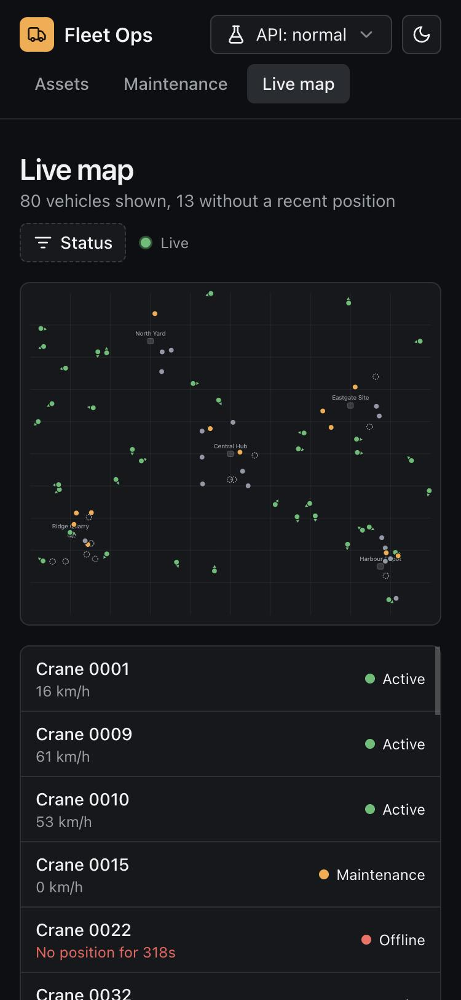
  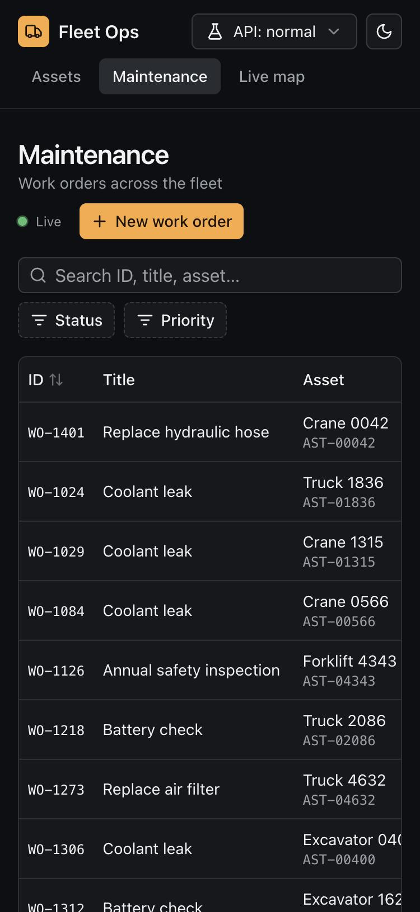
</p>

## How it is built

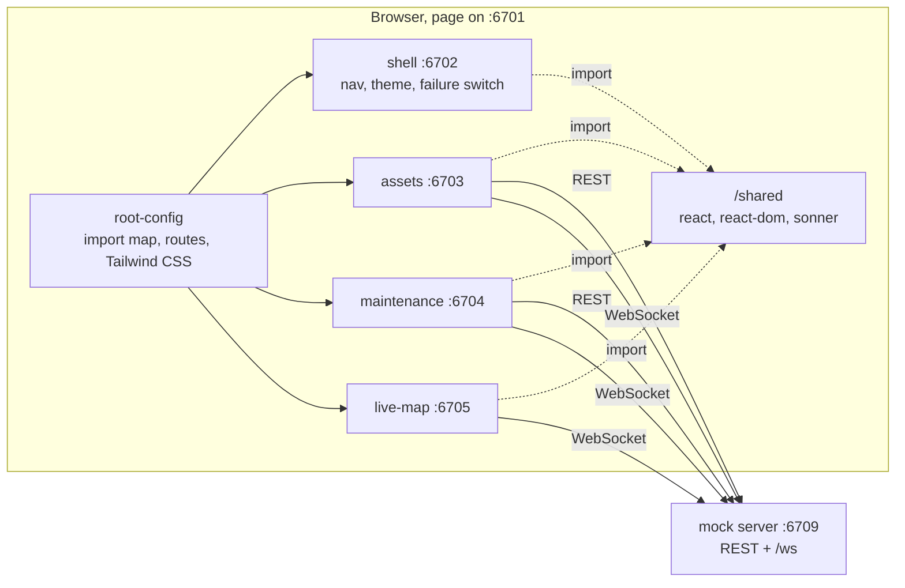

- **Root config** (`apps/root-config`) registers the apps with single-spa, writes the import
  map into `index.html` and shows loading, failed-to-load and not-found states. In dev each
  app is loaded from its own port; in a production build all of them sit under
  `/apps/<name>/` on one origin.
- **Micro-frontends** (`apps/shell`, `apps/assets`, `apps/maintenance`, `apps/live-map`)
  are each built as one ES module that exports single-spa's `bootstrap`, `mount` and
  `unmount`. `packages/app-runtime` gives each one a QueryClient, an error boundary and the
  hooks they share.
- **Shared contract** (`packages/fleet-api`) holds the Zod schemas, the typed fetch client,
  TanStack Query keys and the WebSocket client. The mock server validates requests with the
  same schemas, and the client validates every response.
- **Mock server** (`server/`) is Node `http` plus `ws`. It seeds its data from a fixed seed,
  adds 150 to 600 ms of latency, broadcasts telemetry once a second, and changes a random
  asset's status every four seconds to stand in for another operator.

### Decisions worth explaining

- **One React for every app.** React 19 ships only CommonJS, so
  `apps/root-config/scripts/build-shared-deps.ts` generates ES module entries for `react`,
  `react-dom`, `react-dom/client`, `react/jsx-runtime` and `sonner`, builds them into
  `/shared` and maps them in the import map. Apps mark them external. Sharing sonner too
  means a toast raised in any app shows in the shell's single toaster.
- **One stylesheet.** Tailwind runs once, in the root config, scanning every app. That gives
  the page one preflight and makes theming a single `dark` class on `<html>`. The cost is
  that an app using a new utility class needs the root rebuilt as well.
- **URL as the source of truth for list state.** Page, size, sort and filters are parsed
  from the query string with the shared schema. A bad value drops only that field, so a stale
  link degrades instead of failing.
- **Rollback per item, not per list.** Optimistic updates remember the one record they
  changed. Restoring a whole-list snapshot would also throw away live updates to other rows
  that arrived during the request.
- **Live updates patch in place.** A socket update replaces the row where it is instead of
  refetching, so rows do not jump under the cursor. A row can stop matching the active filter
  until the next page or filter change.
- **Watch builds in dev.** single-spa loads apps cross-origin through the import map, which
  does not fit Vite's dev server well, so each app rebuilds on change and is served
  statically. You reload the page instead of getting hot module replacement. The root config
  retries an app that is still building and says which port it is waiting for.

## Tech stack

| Area          | Tools                                                                                                                |
| ------------- | -------------------------------------------------------------------------------------------------------------------- |
| Frontend      | React 19, TypeScript 5.8, single-spa 6 with single-spa-react, TanStack Query 5, TanStack Table 8, TanStack Virtual 3 |
| UI            | shadcn/ui on Radix, Tailwind CSS 4, lucide-react icons, sonner toasts                                                |
| Data contract | Zod 4 schemas shared by client and server                                                                            |
| Mock backend  | Node `http`, `ws`                                                                                                    |
| Build         | Vite 6, pnpm workspaces                                                                                              |
| Quality       | Vitest 3, Testing Library, jsdom, ESLint 9 (type-aware), Prettier, GitHub Actions                                    |

Vite is pinned to 6.x through a pnpm override so the workspace also runs on Node 20.18,
which Vite 7 does not support.

## Getting started

Requires Node 20.18 or newer (CI uses Node 22) and pnpm, which Corepack provides.

```bash
corepack enable
pnpm install
pnpm dev
```

Open <http://localhost:6701>. `pnpm dev` starts the mock server and all four apps. The first
load can show "Waiting for the … dev server" for a few seconds while the initial builds
finish.

To run the production build:

```bash
pnpm build
pnpm preview
```

| Port | Service                          |
| ---- | -------------------------------- |
| 6701 | Root config, the page you open   |
| 6702 | shell                            |
| 6703 | assets                           |
| 6704 | maintenance                      |
| 6705 | live-map                         |
| 6709 | Mock REST API and WebSocket feed |

No environment variables are required. These are optional:

| Name                 | Used by                            | Default                 |
| -------------------- | ---------------------------------- | ----------------------- |
| `VITE_FLEET_API_URL` | apps, at build time                | `http://localhost:6709` |
| `MOCK_SERVER_PORT`   | mock server                        | `6709`                  |
| `MOCK_LATENCY_MS`    | mock server, maximum added latency | `600`                   |

| Command             | What it does                                                                                        |
| ------------------- | --------------------------------------------------------------------------------------------------- |
| `pnpm dev`          | Mock server plus all apps in watch mode                                                             |
| `pnpm build`        | Builds every micro-frontend, then the root config, and copies the apps into `apps/root-config/dist` |
| `pnpm preview`      | Serves that build on 6701 with the mock server on 6709                                              |
| `pnpm build:vercel` | The hosted demo build: the static site plus the bundled mock server in `.vercel/output`             |
| `pnpm lint`         | ESLint and a Prettier check                                                                         |
| `pnpm typecheck`    | `tsc --noEmit` in every package                                                                     |
| `pnpm test`         | Vitest across all packages                                                                          |

## Project structure

```
apps/
  root-config/   single-spa root, import map, shared-deps build, route status
  shell/         header, navigation, theme menu, API failure switch, toaster
  assets/        virtualized asset table with optimistic status edits
  maintenance/   work orders: create, start, complete, reopen
  live-map/      live vehicle positions on an SVG map
packages/
  fleet-api/     Zod schemas, typed fetch client, query keys, live socket client
  app-runtime/   single-spa lifecycles, QueryClient defaults, shared hooks
  ui/            shadcn/ui components, theme tokens, empty and error states
server/          seeded mock REST API and WebSocket feed
tooling/         micro-frontend registry and shared Vite config
docs/            screenshots and the demo walkthrough
```

## Mock API

All endpoints are on `http://localhost:6709`. There is no authentication. CORS allows
`localhost` origins only.

| Method | Path                   | Body                                    | Returns                   |
| ------ | ---------------------- | --------------------------------------- | ------------------------- |
| GET    | `/api/health`          |                                         | `{ ok: true }`            |
| GET    | `/api/assets`          |                                         | A page of assets          |
| PATCH  | `/api/assets/:id`      | `{ status?, site? }`                    | The updated asset         |
| GET    | `/api/work-orders`     |                                         | A page of work orders     |
| POST   | `/api/work-orders`     | `{ assetId, title, priority, dueDate }` | The new work order, `201` |
| PATCH  | `/api/work-orders/:id` | `{ status }`                            | The updated work order    |

List endpoints take `page`, `pageSize` (up to 1,000), `sort`, `order` and `q`, plus
comma-separated filters: `status`, `type` and `site` for assets, and `status` and
`priority` for work orders. They return `{ items, total, page, pageSize }`.

```http
GET /api/assets?status=maintenance,offline&sort=engineHours&order=desc&pageSize=50
```

Errors are `{ error, issues? }`. A validation error is a `400` with one issue per field, for
example `{ "path": "status.0", "message": "..." }`. An unknown asset on create is a `422`.
A request with the header `x-simulate-failure: mutations` or `all` gets a `503`.

The WebSocket at `/ws` sends JSON messages:

| `type`               | Payload               | When                                       |
| -------------------- | --------------------- | ------------------------------------------ |
| `telemetry.snapshot` | `vehicles`            | Once, on connect                           |
| `telemetry.update`   | `vehicles` that moved | Every second                               |
| `asset.updated`      | `asset`               | After any asset change                     |
| `workOrder.updated`  | `workOrder`           | After any work order is created or changed |

**Data model.** An **asset** has an ID, name, type (truck, excavator, loader, crane,
generator, forklift), status (active, idle, maintenance, offline), site, make, model, year,
engine hours and fuel level. A **work order** belongs to an asset and has a title, priority
(low to critical), status (open, in progress, completed), due date and completion time. A
**vehicle position** belongs to a mobile asset and carries latitude, longitude, speed,
heading and the time it was reported.

## Testing

`pnpm test` runs 74 tests in 23 files. All of them passed on the latest commit, together
with `pnpm lint`, `pnpm typecheck` and `pnpm build`, after a clean install.

| Package     | Tests | What they cover                                                                                                        |
| ----------- | ----- | ---------------------------------------------------------------------------------------------------------------------- |
| server      | 16    | Filtering, priority-rank sorting, paging, validation errors, failure injection, CORS, WebSocket snapshot and broadcast |
| fleet-api   | 12    | Query string round-trips, error mapping, socket reconnect backoff with fake timers                                     |
| app-runtime | 11    | URL list state, the debounced search box, retry policy                                                                 |
| live-map    | 10    | Telemetry merging, stale detection, projection, feed-down and filter states                                            |
| maintenance | 9     | Optimistic create and rollback, status rollback, overdue logic, form validation                                        |
| assets      | 7     | Server paging rendered through the virtualizer, URL sorting, empty and error states, per-row rollback                  |
| ui          | 5     | Pagination bar, empty and error states                                                                                 |
| shell       | 4     | Active navigation, client-side routing, theme persistence                                                              |

The app was also checked by hand in a browser against both the dev setup and the
production build. There are no automated end-to-end tests yet.

CI (`.github/workflows/ci.yml`) runs lint, typecheck, tests and build on pushes to `main`
and on pull requests.

## Deployment

The demo runs on Vercel. `pnpm build:vercel` (the build command in `vercel.json`) writes
[Vercel's Build Output API](https://vercel.com/docs/build-output-api) format to
`.vercel/output`, using [`scripts/build-vercel-output.ts`](scripts/build-vercel-output.ts):

- **Static site.** The normal `pnpm build` output: the root page, every micro-frontend under
  `/apps/<name>/` and the shared React modules under `/shared/`. Unknown paths fall back to
  `index.html`, so `/assets`, `/maintenance` and `/live-map` work on refresh.
- **Mock server as one function.** [`server/src/hosted.ts`](server/src/hosted.ts) exports the
  same Node HTTP server the local mock uses, with the `ws` live feed attached. esbuild bundles
  it with its dependencies into a single ES module, so nothing is resolved or compiled at
  runtime. Every `/api/*` request, including the `/api/ws` WebSocket upgrade, goes to it.
- **Same origin.** The build sets `VITE_FLEET_API_URL` to an empty string, so the apps call
  `/api/*` on the page's own host and open the live feed at `/api/ws`.

Hosting limits that matter for the demo: data lives in memory per function instance, so it
resets when an instance is recycled and two instances can briefly disagree; a WebSocket closes
when the function reaches its maximum duration, and the client reconnects with backoff.

A real deployment would replace the mock with an actual API and set `VITE_FLEET_API_URL` to it.

## Limitations

- State lives in memory on the mock server and resets when it restarts. There is no
  authentication or authorization.
- Only React, ReactDOM and sonner are shared. TanStack Query, Radix and Zod are bundled into
  each app, so each bundle is 80 to 115 kB gzipped.
- Each mounted app opens its own WebSocket rather than sharing one through the shell.
- A new work order shows its asset ID instead of the asset name until the server answers.
- The map is an SVG projection of a fictional area, not real map tiles.

## Roadmap

These are planned, not built:

- Playwright end-to-end tests for the main flows, run in CI.
- One shared WebSocket connection, exposed by the shell as a parcel or event bus.
- Moving TanStack Query into the shared import map once version lockstep is worth it.

## License and contact

No license has been chosen yet, so all rights are reserved for now.

Built by [Usama Khaki](https://github.com/UsamaKhaki).
